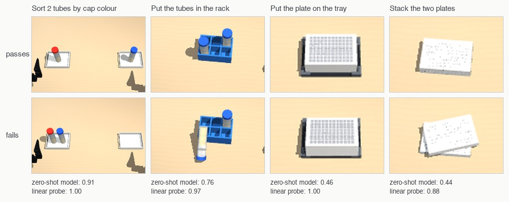

# robot-lab-judge

[](https://github.com/di-omics/robot-lab-judge/actions/workflows/ci.yml)

**Status: simulation only.** A vision judge looks at the camera pictures of a robot lab chore and says PASS or FAIL.
This repo measures how often it is right, and climbs one step at a time. So far: 3 small open-weight models, asked
zero-shot, on 475 scenes. The best one scores 0.65 balanced accuracy, and it is at a coin flip on every plate
chore. A trained judge is the next step.



*Top camera, zoomed in. The 2 chores on the left are easy to read from above, and the best judge so far gets them
mostly right. The 2 on the right are not: a seated plate covers its tray, and a squared stack of 2 plates looks
like 1 plate.*

## What this is

A robot at a lab bench needs a second opinion on its own work. Did the plate really land in the tray? The cheap
second opinion is a vision model that looks at the cameras. This repo asks how good that opinion is, on the chores
of [robot-lab-handling](https://github.com/di-omics/robot-lab-handling): two YAM arms in MuJoCo that rack tubes,
load plates and stack labware.

- **Truth comes from the simulator.** Each chore has a frozen pass rule that reads where the labware ended up.
  No human judging.
- **The judge gets pictures and the task sentence**, nothing else, and answers PASS or FAIL.
- **The costly error is a false pass**: a failed chore that the judge waves through. A judge that filters robot
  training data, or lets a run carry on, has to keep that number low. Every table gives it next to balanced
  accuracy.
- **Every step is scored the same way**, on the same scenes, so the steps can be compared.

Related work: FailBench ([arXiv 2609.03611](https://arxiv.org/abs/2609.03611)) scores 13 vision-language judges on
2,197 robot attempts. Its best judge reaches 0.77 macro balanced accuracy. It has no lab tasks.

Written and run by AI models under the author's direction. No person has reviewed the code or the numbers yet.

## The climb

| Step | Judge | Dev balanced accuracy | Status |
|---|---|---|---|
| 1 | Small open-weight models, zero-shot, last frame | 0.47 to 0.65 | done |
| 2 | The same models, first and last frame | 0.50 to 0.64 | done |
| 3 | Frozen vision features and a small trained head | | in progress |
| 4 | A small model fine-tuned on the train scenes | | not started |
| 5 | Frontier models, zero-shot | | not started |
| 6 | Cameras and lighting the judge has not seen | | not started |
| 7 | Real camera frames | | not started |

The dev split is for comparing steps. The sealed test split gives the final number for a step. Nothing has been
scored on it yet.

## Results so far

Dev split of the scene set: 475 scenes of 10 chores, 283 true passes and 192 true fails. Ranges are exact 95%
(Clopper-Pearson).

<!-- BEGIN BOARD -->
| Judge | Frames | Says PASS on true passes | False passes | Balanced accuracy | Seconds per scene |
|---|---|---|---|---|---|
| `LiquidAI/LFM3-VL-2B-MLX-8bit`, thinking on | last | 121 of 283 (37-49%) | 25 of 192 (9-19%) | 0.65 | 9.9 |
| `LiquidAI/LFM3-VL-2B-MLX-8bit`, thinking on | first + last | 187 of 283 (60-72%) | 67 of 192 (28-42%) | 0.64 | 13.2 |
| `mlx-community/Qwen3.5-4B-4bit` | first + last | 283 of 283 (99-100%) | 190 of 192 (96-100%) | 0.51 | 1.9 |
| `LiquidAI/LFM2.5-VL-450M-MLX-bf16` | first + last | 0 of 283 (0-1%) | 0 of 192 (0-2%) | 0.50 | 0.2 |
| `LiquidAI/LFM2.5-VL-450M-MLX-bf16` | last | 0 of 283 (0-1%) | 0 of 192 (0-2%) | 0.50 | 0.1 |
| `mlx-community/Qwen3.5-4B-4bit` | last | 234 of 283 (78-87%) | 170 of 192 (83-93%) | 0.47 | 1.1 |
| always PASS (reference) | - | 283 of 283 (99-100%) | 192 of 192 (98-100%) | 0.50 | - |
| always FAIL (reference) | - | 0 of 283 (0-1%) | 0 of 192 (0-2%) | 0.50 | - |
<!-- END BOARD -->

- **How the models were run.** MLX builds on an Apple M5 laptop, 1 fixed prompt, temperature 0, no examples. The
  prompt is in [`labjudge/prompts.py`](labjudge/prompts.py). The judge sees the top camera view over both wrist
  views.
- **Thinking.** LFM3-VL-2B was run with thinking on, its default. With thinking off, 30 of its 59 replies on an
  [earlier set](docs/first-look.md) were not PASS or FAIL. Qwen3.5-4B was run with thinking off: with thinking on
  it did not finish within 2048 tokens on 25 of 59 takes of that earlier set.
- **These are small, quantized builds with 1 prompt.** The numbers say how these builds do on this task with this
  prompt. They do not rank the model families.
- **False passes.** The best judge waves through 25 of 192 failed scenes. Adding the first frame raises that to 67
  of 192, for about the same balanced accuracy.

All verdicts, with each model's full reply, are in [`results/simset_dev/`](results/simset_dev/). More cuts (by kind
of failure, by distance) are in [`results/simset_dev/breakdown.md`](results/simset_dev/breakdown.md).

## The finding so far: from above, a neat result hides its evidence

Balanced accuracy of the best judge, chore by chore:

<!-- BEGIN BY CHORE -->
| Chore | True passes | True fails | Last frame | First + last frame |
|---|---|---|---|---|
| `sort_by_cap` | 37 | 11 | 0.91 | 0.91 |
| `bottle_to_shelf` | 38 | 10 | 0.81 | 0.85 |
| `tubes_to_rack` | 31 | 16 | 0.76 | 0.78 |
| `tubes_to_waste` | 39 | 9 | 0.69 | 0.94 |
| `stack_tip_boxes` | 23 | 25 | 0.52 | 0.61 |
| `plate_to_hotel_bottom` | 26 | 18 | 0.50 | 0.44 |
| `plate_to_hotel_top` | 27 | 21 | 0.50 | 0.52 |
| `unstack_plate` | 19 | 29 | 0.48 | 0.44 |
| `plate_to_tray` | 20 | 28 | 0.46 | 0.36 |
| `stack_plates` | 23 | 25 | 0.44 | 0.28 |
<!-- END BY CHORE -->

The judge is good where the result is visible from above: tubes in a tray, a bottle on a platform, tubes in a
rack. It is at a coin flip, or below it, on every chore that handles a plate.

Its saved reasoning says why. A keyword count over the reasoning text for the 8 clean, passing scenes of each
chore ([the counts and the exact patterns](results/simset_dev/reasoning_keywords.md)):

<!-- BEGIN KEYWORDS -->
| Chore | Clean scenes | Judged FAIL | Its reasoning speaks of | In |
|---|---|---|---|---|
| `stack_plates` | 8 | 8 of 8 | a single plate | 8 of 8 |
| `plate_to_tray` | 8 | 8 of 8 | no tray, or the plate is not on a tray | 7 of 8 |
| `unstack_plate` | 8 | 8 of 8 | - | - |
| `plate_to_hotel_top` | 8 | 8 of 8 | - | - |
| `plate_to_hotel_bottom` | 8 | 8 of 8 | - | - |
| `stack_tip_boxes` | 8 | 5 of 8 | - | - |
<!-- END KEYWORDS -->

A squared stack of 2 plates looks like 1 plate from above, and a seated plate covers its tray.

Showing it the first frame as well helps where the start makes the change obvious: binning used tubes goes from
0.69 to 0.94. It does not help the plate chores. On stacked plates it then does worse than a coin flip: it says
PASS on 1 of 23 true passes and on 12 of 25 true fails. The likely reason is the same one turned around. A sloppy
stack shows 2 plates, which reads as stacked. A neat stack shows 1, which reads as nothing done.

So the open question for the next step is whether the answer is in these pixels at all. If a judge trained on the
train scenes still cannot tell a neat plate result from a failed one, the fix is a lower camera, not a better
model.

## The scene set

The scenes are end states of a chore with the labware a little off: shifted, tipped, half done, untouched, or one
of the chore's own look-alike failures. Truth is the frozen pass rule on the settled end state.

| Split | Scenes | Layout seeds | Use |
|---|---|---|---|
| train | 1,768 | 10000 to 10029 | fit a judge |
| dev | 475 | 20000 to 20007 | compare steps, choose prompts and thresholds |
| test | 1,537 | 30000 to 30019 | sealed; the final number for a step |

3 chores appear only in the test split, to measure chores a trained judge has not seen. How the scenes are made,
how far a prop can move before a chore fails, and what sealing means here: [docs/scene-set.md](docs/scene-set.md).

## Where things are

| I want to | Look in | Command |
|---|---|---|
| Read the results | [`results/simset_dev/board.md`](results/simset_dev/board.md), [`breakdown.md`](results/simset_dev/breakdown.md) | |
| Read what a model said about a scene | `results/simset_dev/verdicts_*.jsonl` (1 line per scene) | |
| Score saved verdicts again | `labjudge/score.py` | `python -m labjudge board --results results/simset_dev` |
| Ask a local model to judge the dev scenes | `labjudge/judge_mlx.py`, `labjudge/prompts.py` | `python -m labjudge judge --data data/simset/dev --results results/simset_dev --conditions after` |
| Make the scenes again | `labjudge/simset/` ([how](docs/scene-set.md)) | `python -m labjudge.simset generate --split dev` |
| See which scenes exist and why each passes or fails | `data/simset/train/manifest.jsonl`, `data/simset/dev/manifest.jsonl` | |
| Check that the test split is the sealed one | `data/simset/test/SEALED.md`, `results/sealed_log.jsonl` | `python -m labjudge.simset check` |
| Read the earlier look at recorded takes | [docs/first-look.md](docs/first-look.md), `results/first_look/` | |
| Redraw the figure and the tables above | `tools/` | `python tools/make_figures.py`, `python tools/update_readme.py` |

The Python package is `labjudge`. Pictures are not in the repo: they are large, and the simulator makes them again
from the seeds.

## Running it

Scoring the saved verdicts needs only Python 3.12. The tests also need numpy, pillow, av and pytest:

```
python -m labjudge board --results results/simset_dev
python -m labjudge breakdown --data data/simset/dev --results results/simset_dev
python -m pytest -q
```

Judging needs Apple silicon, [uv](https://docs.astral.sh/uv/) and the model in the local Hugging Face cache:

```
uv sync
HF_HUB_OFFLINE=1 uv run python -m labjudge judge --model LiquidAI/LFM2.5-VL-450M-MLX-bf16 \
    --data data/simset/dev --results results/simset_dev --conditions after before_after
```

For a model that thinks, add `--thinking --max-tokens 2048`. A reply that never closes its thinking has no answer
and counts as wrong. A run writes to a `.partial` file and renames it when every scene is in, so a stopped run is
never scored.

Making the scenes needs the simulator of robot-lab-handling and its Python environment. See
[docs/scene-set.md](docs/scene-set.md).

## Limits

- **Simulation only.** Nothing here says how a judge does on real camera frames.
- **Still scenes, arms at rest.** Both arms are at home in every scene, so the wrist views show almost no labware.
  A real attempt ends with the arms anywhere.
- **The dev split is small and clustered.** Scenes come about 6 to a layout, 80 layouts in all, so the exact
  ranges are somewhat too narrow.
- **Some pass rules are loose.** A bottle anywhere on the platform passes. A tip box up to about 26 mm off centre
  still counts as stacked. A true pass can look untidy.
- **Dev is not the test.** Prompts and thresholds are chosen on dev. Final numbers come from the sealed split.
- **2 chores are left out.** `rack_carry` and `tube_handover` pass only if something happened on the way, which a
  still picture cannot show.

## License

MIT, see [LICENSE](LICENSE). The models have their own licenses: see each model card.
